


 

 

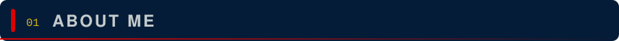

 


 

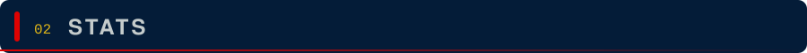

 

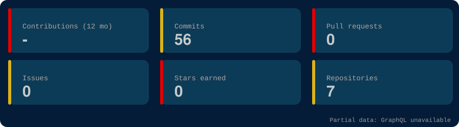

 

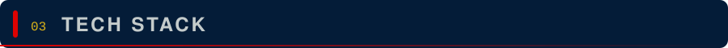

 

**Languages** 

**Frontend** 

**Backend and Database** 

**Security and Tools** 

 


 

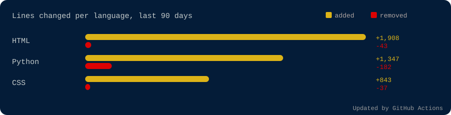

 

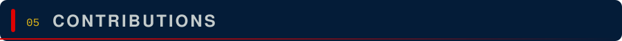

 

 

 

 


 

 
 


 

 

Learning to break things so I can help secure them.

